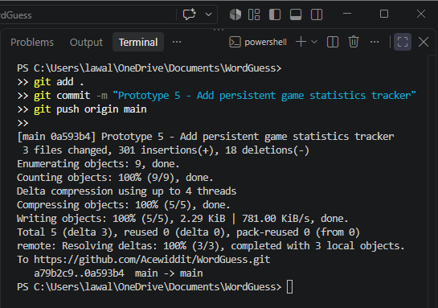
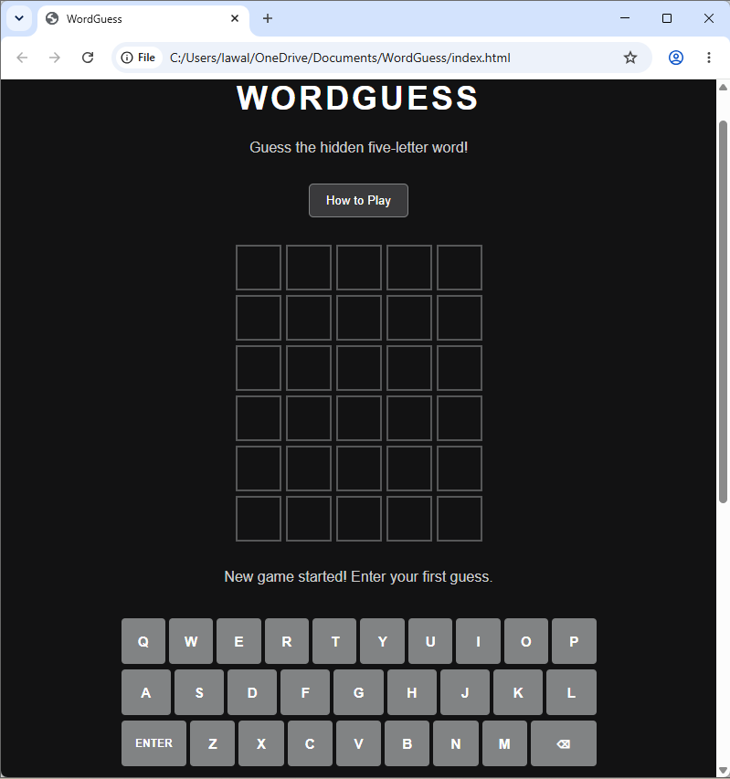
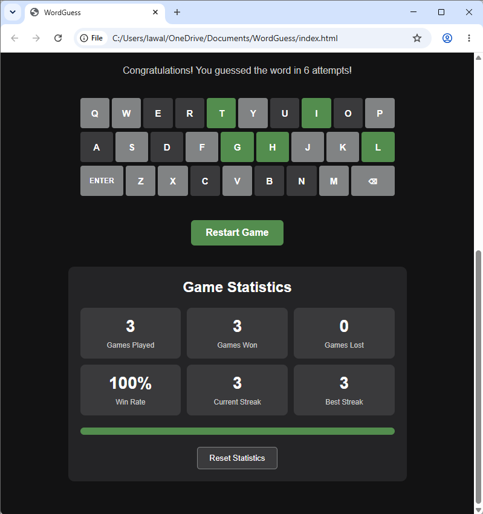
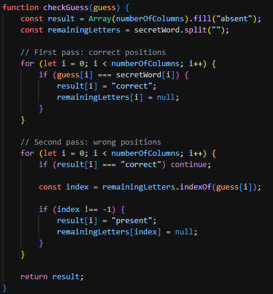

# WordGuess – Interactive Word Guessing Game

## 1. Project Overview

WordGuess is a browser-based word guessing game developed using HTML5, CSS3 and JavaScript. The project was created as part of a university software development assignment to demonstrate programming, interface design, iterative prototyping, testing and version control.

The game challenges players to identify a randomly selected five-letter word within six attempts. After each valid guess, the application provides colour-coded feedback to help players determine which letters are correct.

The application also includes an on-screen keyboard, word validation, instructions, a restart function and a statistics tracker that saves completed game results.

**Technologies:** HTML5, CSS3, JavaScript, Git and GitHub Pages.


**GitHub Repository:** [https://github.com/Acewiddit/WordGuess]

## 2. Project Aim and Objectives

The main aim was to design and develop a functional, accessible and responsive word guessing game using client-side web technologies.

The objectives were to:

- Develop an interactive 6 × 5 game board.
- Implement physical and on-screen keyboard input.
- Validate user guesses.
- Provide accurate colour-coded feedback.
- Detect winning and losing conditions.
- Implement a restart function.
- Create an additional statistics-tracking feature.
- Test the application throughout development.
- Deploy the finished application online.
- Maintain a GitHub repository documenting project progress.

## 3. Target Audience and User Profile

WordGuess is intended for students, casual gamers and individuals who enjoy word puzzles.

**Example user profile**

Name: Fareeda

Age: 19

Experience: Familiar with web browsers and casual mobile games.

Goals: Play a quick and enjoyable word puzzle without installing additional software.

Needs: Clear instructions, responsive controls, immediate feedback and an interface that works on different screen sizes.

This profile was used to guide decisions about the game's layout, instructions and input methods.

## 4. Requirements Analysis

### 4.1 Functional Requirements

| ID | Requirement | Priority |
|---|---|---|
| FR01 | Generate a random five-letter hidden word | High |
| FR02 | Display a six-row, five-column board | High |
| FR03 | Accept physical keyboard input | High |
| FR04 | Support an on-screen keyboard | High |
| FR05 | Validate submitted guesses | High |
| FR06 | Display green, yellow and grey feedback | High |
| FR07 | Detect winning and losing conditions | High |
| FR08 | Allow players to restart | High |
| FR09 | Display instructions | Medium |
| FR10 | Record completed game statistics | Medium |
| FR11 | Save statistics between browser sessions | Medium |

### 4.2 Non-Functional Requirements

| ID | Requirement |
|---|---|
| NFR01 | The interface should be simple to understand |
| NFR02 | The application should support desktop and mobile screen sizes |
| NFR03 | Feedback should appear promptly after a valid guess |
| NFR04 | The source code should be readable and maintainable |
| NFR05 | The game should be accessible through a web browser |
| NFR06 | Game feedback should provide accessible text descriptions |
| NFR07 | The game should not require an account or external database |

## 5. Development Methodology

An evolutionary prototyping approach was used to develop WordGuess.

The project was divided into five main prototypes. Each version introduced additional functionality while retaining and improving previously implemented features.

This approach allowed individual components to be developed and tested before being integrated into the completed game.

### Prototype 1 – Game Board

The first prototype established the basic HTML structure, CSS styling and JavaScript-generated game board.

Nested loops were used to create six rows containing five tiles each.

### Prototype 2 – Keyboard Input

The second prototype introduced keyboard event handling, allowing users to enter and delete letters.

Basic input validation prevented guesses containing fewer than five letters from being submitted.

### Prototype 3 – Word Selection and Feedback

The third prototype introduced random word selection, letter comparison and colour-coded feedback.

A two-pass comparison algorithm was implemented to handle repeated letters correctly.

Winning and losing conditions were also introduced.

### Prototype 4 – User Interface Improvements

The fourth prototype added an on-screen keyboard, accepted-word validation, instructions and responsive styling.

Keyboard colour priorities were implemented so that previously identified correct letters retained their most informative feedback.

### Prototype 5 – Statistics Tracking

The fifth prototype introduced an additional feature that records completed games, wins, losses, win percentage and winning streaks.

JavaScript localStorage was used to preserve statistics between browser sessions.

### Final Refinement

The final development stage focused on responsive layout, keyboard focus visibility, reduced-motion support and end-to-end testing.

**Development evidence:** []

## 6. System Design

### 6.1 Interface Design

The application uses a dark interface with a central 6 × 5 game board, an on-screen keyboard and a statistics section.

The layout was designed to minimise distractions and make the guessing process straightforward.

**Final interface:** []

### 6.2 Program Logic

The main program follows this process:

1. Initialise the game.
2. Select a random hidden word.
3. Create the game board and keyboard.
4. Wait for player input.
5. Validate a submitted guess.
6. Compare the guess with the hidden word.
7. Display letter feedback.
8. Check for a win or loss.
9. Record statistics when the game ends.
10. Allow the player to restart.

### 6.3 Pseudocode

```text
START GAME

Select a random five-letter word
Set attempt count to zero
Create game board
Create on-screen keyboard

WHILE game is not over

    Accept player input

    IF Enter is pressed THEN

        IF guess is not five letters THEN
            Display validation message

        ELSE IF guess is not recognised THEN
            Display invalid word message

        ELSE
            Compare guess with hidden word
            Identify correct-position letters
            Identify wrong-position letters
            Display feedback

            IF guess equals hidden word THEN
                Display winning message
                Record win
                End game

            ELSE
                Increase attempt count

                IF six attempts have been used THEN
                    Display losing message
                    Record loss
                    End game
                END IF
            END IF
        END IF
    END IF

END WHILE

Save completed game statistics

END
```

## 7. Implementation

### HTML5

HTML5 provides the structural elements of the application, including the heading, game board container, instructions, keyboard container and statistics dashboard.

### CSS3

CSS3 controls the visual appearance of the game, including the dark theme, tile colours, keyboard layout, responsive design and focus indicators.

CSS Grid is used to organise the game board, while Flexbox is used for the on-screen keyboard.

### JavaScript

JavaScript controls the main functionality, including:

- Dynamic board generation.
- Keyboard event handling.
- Random word selection.
- Guess validation.
- Letter comparison.
- Game state management.
- Statistics calculation.
- Browser storage.

### Git and GitHub

Git was used to maintain version control throughout development.

Separate commits were created for the initial setup and subsequent prototypes, allowing development progress to be reviewed through the repository history.

## 8. Testing

Testing was performed throughout development to check individual features before progressing to the next prototype.

The tests covered board generation, keyboard input, validation, colour feedback, winning and losing conditions, restart functionality, statistics and responsive behaviour.

**Prototype test records:** [<video controls src="20261031-0016-56.2021527.mp4" title="Title"></video>]

**Final testing evidence:** []

Testing was also carried out on the deployed GitHub Pages application to check that the game worked outside the local development environment.

## 9. Technical Challenges and Solutions

One significant technical challenge involved handling repeated letters during guess comparison.

A simple comparison approach could incorrectly mark repeated letters as present even when the hidden word contained fewer occurrences of that letter.

The solution was to use a two-pass algorithm.

The first pass identifies letters in their correct positions and removes those occurrences from further matching. The second pass checks remaining guessed letters against the unmatched letters in the hidden word.

This improves feedback accuracy when guesses contain duplicate characters.

**Evidence:** []

## 10. Additional Functionality – Statistics Tracker

The statistics tracker was implemented as an extension beyond the basic word guessing game.

It records:

- Total completed games.
- Games won.
- Games lost.
- Win percentage.
- Current winning streak.
- Best winning streak.

The feature uses localStorage to retain results between browser sessions.

One limitation is that statistics are stored locally rather than synchronised across devices.

## 11. Deployment

WordGuess was deployed using GitHub Pages.

The application consists of static HTML, CSS and JavaScript files and does not require a backend server.

**Deployment URL:** [file:///C:/Users/lawal/OneDrive/Documents/WordGuess/index.html]

The deployed application was tested to confirm that its main features worked correctly.

## 12. Limitations and Future Improvements

The current version uses a relatively small collection of accepted words, which restricts the range of valid guesses.

Potential improvements include:

- Expanding the accepted-word dictionary.
- Adding difficulty levels.
- Introducing daily challenges.
- Improving accessibility through additional screen-reader testing.
- Adding more detailed statistics and performance charts.

These improvements were considered outside the initial project scope but could be introduced in future versions.

## 13. How to Run the Application

1. Open the deployed WordGuess website.
2. Read the instructions using the How to Play button.
3. Enter a five-letter word using the physical or on-screen keyboard.
4. Press Enter to submit the guess.
5. Use the colour feedback to guide subsequent attempts.
6. Guess the hidden word within six attempts.
7. Select Restart Game to play again.

Alternatively, clone the GitHub repository and open `index.html` in a browser.

## 14. References and Learning Resources

## 14. References and Learning Resources

The following resources provide documentation and learning material relevant to the technologies and techniques used in developing WordGuess.

### References

freeCodeCamp (n.d.) *JavaScript Algorithms and Data Structures Certification*. Available at: https://www.freecodecamp.org/learn/javascript-algorithms-and-data-structures-v8/ (Accessed: 31 October 2026).

GitHub (n.d.) *About GitHub Pages*. Available at: https://docs.github.com/en/pages/getting-started-with-github-pages/what-is-github-pages (Accessed: 31 October 2026).

MDN Web Docs (n.d.) *Document Object Model (DOM)*. Available at: https://developer.mozilla.org/en-US/docs/Web/API/Document_Object_Model (Accessed: 31 October 2026).

MDN Web Docs (n.d.) *JavaScript Guide*. Available at: https://developer.mozilla.org/en-US/docs/Web/JavaScript/Guide (Accessed: 31 October 2026).

MDN Web Docs (n.d.) *Using the Web Storage API*. Available at: https://developer.mozilla.org/en-US/docs/Web/API/Web_Storage_API/Using_the_Web_Storage_API (Accessed: 31 October 2026).

MDN Web Docs (n.d.) *CSS Grid Layout*. Available at: https://developer.mozilla.org/en-US/docs/Web/CSS/CSS_grid_layout (Accessed: 31 October 2026).

MDN Web Docs (n.d.) *KeyboardEvent*. Available at: https://developer.mozilla.org/en-US/docs/Web/API/KeyboardEvent (Accessed: 31 October 2026).

W3C Web Accessibility Initiative (n.d.) *Introduction to Web Accessibility*. Available at: https://www.w3.org/WAI/fundamentals/accessibility-intro/ (Accessed: 31 October 2026).

### Learning Resources

The development of WordGuess involved applying JavaScript programming concepts such as variables, arrays, functions, loops, conditional statements, event listeners and DOM manipulation.

Relevant technical documentation covers the following areas:

- **HTML5 and CSS3:** Structuring the webpage, designing the game board and creating responsive layouts.
- **JavaScript:** Implementing game logic, processing user input, validating guesses and providing colour-coded feedback.
- **DOM manipulation:** Dynamically generating game tiles and updating interface elements.
- **Web Storage API:** Saving game statistics using localStorage.
- **GitHub Pages:** Hosting and deploying the completed application.
- **Web accessibility:** Supporting keyboard navigation, accessible labels and clear visual feedback.